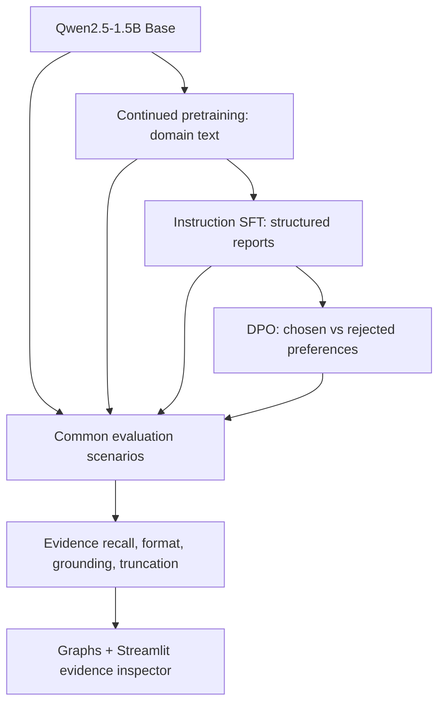
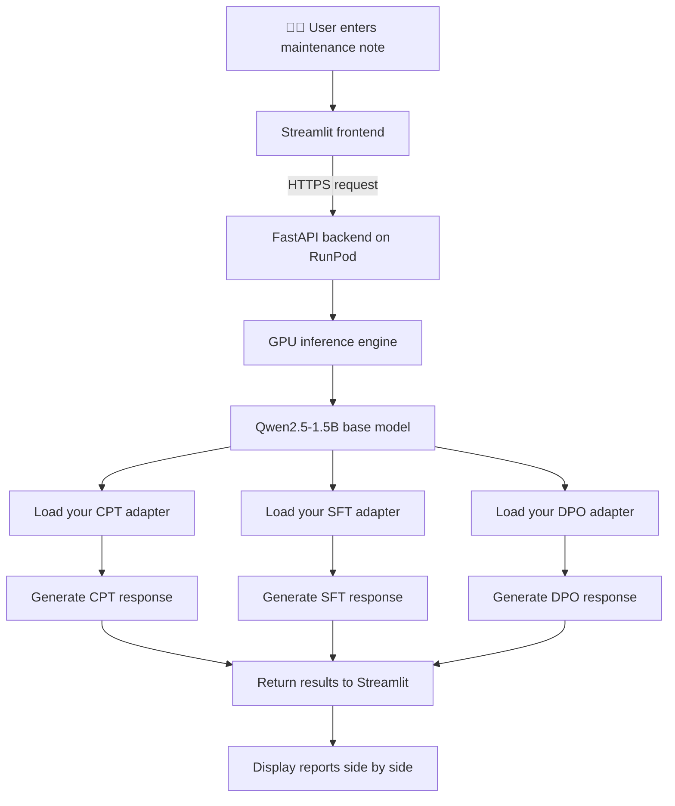
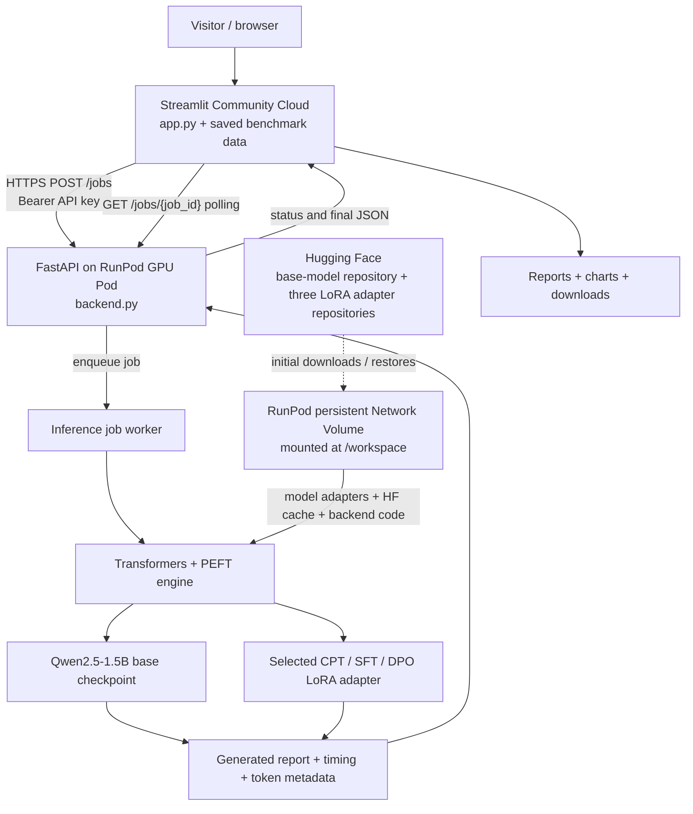

#  Industrial Maintainence Documentation Aid — An Experimental Study on LLM Post-Training & Alignment

**Continued Pretraining (CFT) · Supervised Fine-Tuning (SFT) · Direct Preference Optimization (DPO) · Comparative Evaluation**

**Domain-specific industrial maintenance documentation assistant and LLM post-training research project.** This prototype transforms unstructured equipment observations and technician notes into structured **draft maintenance reports** for maintenance, operations, and reliability teams. It provides a consistent, reviewable format for reported symptoms, operating conditions, measurements, possible contributors, uncertainty, and suggested follow-up—**without claiming to diagnose equipment faults**.

Alongside the practical document-assistant use case, this independent study compares four Qwen2.5-1.5B checkpoints—Base, continued pretraining (CPT), supervised fine-tuning (SFT), and direct preference optimization (DPO)—to investigate how domain adaptation, instruction-following, and preference alignment influence the accuracy and structure of generated maintenance documentation.

> **Research question:** Does additional post-training improve the reliability of generated reports—or mainly change their structure and learned response preferences?

**Base model:** Qwen2.5-1.5B · **Training:** 4-bit quantization + LoRA/QLoRA · **Environment:** Python / Google Colab / NVIDIA GPU

# Try it out 

**Prototype link:** https://llm-post-training-and-alignment-aug26.streamlit.app/

### How to use the maintenance document assistant

1. **Open the prototype** using the link above and select **Try a new note** in the sidebar.
2. **Enter a technician observation.** Paste a fictional or non-confidential maintenance note describing equipment, symptoms, measurements, timestamps, actions already taken, and any unknowns. Avoid private plant records or sensitive operational data.
3. **Choose checkpoints.** Select **Base Qwen**, **CPT**, **SFT**, and/or **DPO**. For a quick demonstration, start with **SFT**; select multiple checkpoints to compare post-training behavior.
4. **Set the maximum output tokens** using the slider (for example, 350), then click **Generate with my fine-tuned Qwen models**.
5. **Review the generated draft reports.** Inspect the structured maintenance sections side by side. Check that equipment IDs, values, timestamps, negative findings, and uncertainty are preserved; treat suggested contributors as unconfirmed possibilities.
6. **Compare the live metrics.** Explore **Latency**, **Generation speed**, **Schema coverage** (heading presence), and **Token usage**. Download the current outputs as **JSON** and live metrics as **CSV** if needed.
7. **Explore the research results** through **Research overview**, **Checkpoint comparison**, **Evidence inspector**, and **Methods & limits**. These saved benchmark views work even when the live GPU is offline.

**Example fictional maintenance note:**

> During monitoring of centrifugal gas compressor K-204, vibration increased from 2.8 mm/s to 6.4 mm/s over 40 minutes. Discharge temperature rose from 82°C to 96°C while suction pressure remained steady at 18 bar. An intermittent noise was observed near the drive-end bearing. The compressor was placed on standby at 14:35 pending inspection. The cause is unconfirmed; no vibration spectrum analysis or internal inspection has been performed.

**Availability:** The Streamlit dashboard and saved research results remain accessible when the RunPod GPU is stopped, but **new live reports require the FastAPI GPU backend to be running**. The current Pod deployment does not auto-start when a visitor clicks Generate.

**Intended workflow:** This is a *drafting and comparison assistant*, not an autonomous maintenance decision-maker. A qualified engineer must check source fidelity and approve any documentation before organizational use. The current prototype is not a certified QA/QC report generator or fault-diagnosis system.

## Background: From Transformers to Post-Training

This project builds on my earlier **Transformer-from-scratch implementation**, where I explored the architecture and mechanics behind language models rather than relying solely on pretrained model APIs.

The next step was to understand what happens *after* pretraining: how a model is adapted to a domain, taught to follow instructions, and aligned with preferred responses. For that reason, this study uses an existing open-weight model and focuses on **post-training methods**, not on rebuilding the transformer architecture.

**Previous work:** [My GitHub portfolio](https://github.com/imavantikahere) — replace this with the **direct link to my Transformer-from-scratch repository** before publishing.

## Project Objectives

1. Apply **continued pretraining** on a small, synthetic industrial maintenance corpus to study domain adaptation through next-token prediction.
2. Use **instruction SFT** to teach structured maintenance-report generation.
3. Apply **DPO** to train on chosen/rejected response preferences emphasizing evidence-grounded, uncertainty-aware reporting.
4. Compare the saved checkpoints on consistent maintenance scenarios, separating **formatting, evidence completeness, unsupported claims, and preference discrimination**.
5. Build an **interactive Streamlit research dashboard** to present real saved model outputs and evaluation findings.

## Technology Stack

| Technology | Role |
|---|---|
| **Python** | Dataset processing, training orchestration, inference and evaluation |
| **PyTorch** | Underlying tensor operations and model execution |
| **Hugging Face Transformers** | Model loading, tokenization, text generation |
| **Hugging Face Datasets** | JSONL dataset loading, validation and splits |
| **Unsloth** | Memory-efficient model loading and fine-tuning |
| **PEFT / LoRA / QLoRA** | Train adapter parameters with a quantized pretrained model |
| **TRL** | `SFTTrainer` and `DPOTrainer` training workflows |
| **bitsandbytes** | Low-bit quantization and optimizer support |
| **Google Colab + Google Drive** | GPU experimentation and checkpoint persistence |
| **pandas / Matplotlib** | Comparative results, manual-audit exports and plots |
| **Streamlit** | Deployed maintenance-document assistant UI, saved benchmark dashboard, live checkpoint comparisons |
| **FastAPI + Uvicorn** | Authenticated job-based inference API (`POST /jobs`, `GET /jobs/{job_id}`) |\n| **RunPod + Network Volume** | GPU-hosted inference and persistent adapter/backend/model-cache storage |\n| **Git / GitHub** | Version control and documentation |

## Scope of the Study

**In scope:** dataset preparation, QLoRA-based continued pretraining, instruction SFT, DPO, checkpoint verification, controlled model comparisons, error analysis and reproducible documentation.

**Out of scope:** full foundation-model pretraining, PPO-style RLHF, a separately trained reward model, real-time industrial control, fault confirmation, a production-validated industrial deployment and a live RAG service. A working educational live GPU prototype is deployed, but production-grade safety and QA/QC integration remain out of scope. Retrieval-augmented generation and structured evidence extraction are potential future extensions—not part of this controlled comparison.

The project is an **educational experimental study**, not a production-ready maintenance diagnostic system.

## Experimental Pipeline



**Experimental-control note:** To isolate the *incremental benefit* of continued pretraining, a direct **Base → SFT** control is required alongside **Base → Continued Pretraining → SFT**. Without this control, the pipeline comparison does not establish that continued pretraining itself caused a downstream improvement.

## Datasets

All datasets are **synthetic** and designed for this limited educational experiment.

| Dataset | Size | Purpose |
|---|---:|---|
| Maintenance-domain text | 300 paragraphs | Continued pretraining / next-token prediction |
| Instruction-response data | 180 examples (60 scenarios × 3 variants) | Seven-field structured maintenance reports |
| Preference data | 120 chosen/rejected pairs | Cautious, evidence-grounded response selection |
| Comparative benchmark | 10 initial synthetic scenarios | Same-prompt inference and evidence-level review |

**Dataset design considerations:** Train/validation splitting was grouped by underlying scenario or equipment identifier where applicable. The benchmark also requires review for scenario paraphrase overlap. Synthetic labels may omit secondary evidence or contain repeated patterns, so dataset quality is part of the interpretation.

### Target reporting format

```text
Equipment:
Reported issue:
Observed evidence:
Possible contributors (not confirmed):
Missing information:
Recommended follow-up:
Assessment:
```

The reporting objective is to document *what was observed*, distinguish that from *what is hypothesized*, and flag missing information—**not** to issue definitive engineering diagnoses.

## Notebook Walkthrough

| Notebook | Experimental stage | Main output |
|---|---|---|
| `01_data_preprocessing.ipynb` | Clean, validate and prepare raw text, instruction and preference JSONL | Prepared datasets |
| `02_non_instruction_finetuning.ipynb` | Continued pretraining using QLoRA on domain text | Domain adapter + training metrics |
| `03_instruction_sft.ipynb` | Completion-only supervised fine-tuning for report generation | SFT adapter + sample reports |
| `04_dpo_alignment.ipynb` | Preference optimization against chosen/rejected pairs | DPO adapter + preference metrics |
| `05_comparative_evaluation.ipynb` | Same-prompt inference, evidence-level checks, graphs | Comparison tables + manual-audit CSV |

Training follows a sequential pipeline, with each stage saving its adapter independently. The implementation draws on post-training concepts studied through an independent AI bootcamp; the industrial reporting task, comparative framing and evidence-inspection workflow are the applied case study explored here.

## Evaluation & Results

This benchmark compares **four checkpoints on the same 10 synthetic technician notes** (40 generated reports): the original Qwen2.5-1.5B model, the continued-pretraining (CPT) adapter, the instruction SFT adapter, and the preference-optimized DPO adapter. The evaluation uses cached generated reports rather than presenting model-training diagnostics as downstream accuracy.

### Evaluation design

Each report was assessed along independent dimensions:

| Dimension | Definition | Review method |
|---|---|---|
| **Evidence preservation** | Fraction of source-observation checkpoints accurately retained, including critical quantities and qualifiers | 53 checklist items per checkpoint, scored 0/1; AI-assisted single-reviewer labels, with human confirmation recommended |
| **Required-field coverage** | Fraction of the seven target field labels detectable in the report | Automated heading-presence check |
| **Complete seven-field presence** | Share of reports containing all seven required field labels | Automated all-or-nothing heading-presence check |
| **Unsupported observations** | Reports containing fabricated or unsupported source facts, measurements or observed events | Report-level 0/1 audit |
| **Unsupported interpretations** | Reports asserting technical interpretations beyond what source evidence justifies | Report-level 0/1 audit |
| **Visible truncation** | Reports that end mid-sentence or mid-structure | Report-level 0/1 audit |

**Scoring boundary:** Field-presence checks do **not** verify section order, nonempty sections, factual correctness or semantic compliance. The evidence and unsupported-claim annotations are **AI-assisted proposed review judgments**, not independent expert-validated ground truth. This is a descriptive study, not a formal reliability certification.

### Comparative results

| Checkpoint | Evidence preservation | Required-field coverage | All 7 fields present | Unsupported observations | Unsupported interpretations | Visibly truncated |
|---|---:|---:|---:|---:|---:|---:|
| **Base Qwen** | **94.3%** | 10.0% | 0/10 | 0/10 | 6/10 | 3/10 |
| **CPT** | 65.8% | 12.9% | 0/10 | 3/10 | 5/10 | 1/10 |
| **SFT** | 42.7% | **100%** | **10/10** | **0/10** | **1/10** | **0/10** |
| **DPO** | 58.3% | **100%** | **10/10** | 3/10 | 2/10 | **0/10** |

**How to read the table:** Evidence preservation is the average of each case's fraction of retained checklist items (which may differ slightly from a single global sum across all 53 items). The final three columns count **reports flagged** in each category, rather than individual sentences or errors. A report can receive more than one flag.

**These figures reflect the saved assessment files as discussed during development; independent human adjudication has not been established.** Some boundary cases are judgment-sensitive. Do not treat differences here as statistically significant or broadly generalizable.

### Evaluation visualizations


*Figure 1. Evidence preservation compared with coverage of the seven requested fields. The chart was generated from the corrected field-presence metric; the notebook plot title/legend may still use “schema compliance,” which here means field presence only.*


*Figure 2. Number of reports flagged for unsupported observations, unsupported interpretations and visible truncation (10 reports per checkpoint). Annotations are AI-assisted and should be manually checked.*

> **Figure files:** Copy `final_recall_schema.png` and `final_failure_modes.png` from the notebook's Google Drive `results/evaluation_05/` directory into the **same path inside this GitHub repository**. Otherwise these relative Markdown images will not render.

### Interpretation

1. **Base Qwen preserved the most source observations (94.3%)**, but often used longer prose, made unsupported technical inferences (6/10 reports), and visibly truncated 3/10 reports. High recall alone is not sufficient for reliable reporting.
2. **Continued pretraining did not establish a downstream advantage** in this sequential study. CPT retained 65.8% of evidence checkpoints, while generating some repetitive or unwarranted claims such as asserting trend stability or treating brief shuddering as harmless. This comparison does not isolate the causal contribution of CPT.
3. **SFT successfully standardized the output**: all seven field labels appeared in all ten reports, with no visible truncation. However, strict evidence preservation fell to 42.7%, suggesting that concise schema-driven answers can omit important technician observations.
4. **DPO recovered some evidence relative to SFT**: 58.3% vs. 42.7% (**+15.6 percentage points**) with the same seven-field presence. But 3/10 DPO reports were flagged for unsupported observations, compared with 0/10 for SFT. In this benchmark, DPO did not uniformly improve grounding.

**Representative failure case — Pump P-883:** The source note gave a pressure reading of **4.1 bar**, not a pressure fluctuation. The DPO output introduced *“pressure fluctuation”* as a reported observation. The CPT output repeatedly asserted *“trend consistency”* without a documented trend, while both SFT and DPO omitted several secondary details. Base Qwen retained more of the listed evidence but added questionable interpretations.

### DPO optimization diagnostics — not report-quality scores

| Metric | Recorded result |
|---|---:|
| Training steps / completed epochs | 30 / ~1.16 |
| Average training loss | 0.4157 |
| Validation loss | 0.2601 |
| Validation preference reward accuracy | 100% |
| Validation reward margin | +1.4401 |
| Matched LoRA tensors differing between SFT and DPO | 392 / 392 |
| Maximum absolute adapter-weight difference | 0.00154053 |

The saved DPO adapter changed measurably, and the preference metric reached 100% **on a very small synthetic validation split**. It does **not** represent 100% factual accuracy or industrial robustness. Greedy-decoded outputs can also remain unchanged despite changes to model weights.

### Main research finding

> **Post-training optimized different behaviors rather than producing a monotonic increase in report reliability.** SFT and DPO achieved complete seven-field heading presence, but Base Qwen retained more source details. DPO partly improved evidence retention over SFT, while introducing some additional unsupported observations. This is a small, synthetic, AI-assisted review and should be interpreted descriptively.

## Reproducing the Experiments

1. Clone the repository and open the notebooks in order in **Google Colab**.
2. Prepare the three synthetic datasets and validate the processed JSONL columns.
3. Select a compatible CUDA GPU for model training or inference.
4. Update each notebook's `ROOT` / `PROJECT_ROOT`, model paths and dataset filenames to match your Google Drive.
5. Run stages 02–04 in sequence, saving adapters separately; run 05 using the exact saved checkpoints.
6. Evaluate the saved outputs; audit evidence preservation, unsupported claims and visible truncation; generate the final figures and exports.
7. Review the AI-assisted labels independently before describing them as expert-verified results.

The notebooks expect a workspace similar to:

```text
llm-post-training-experimental-study/
├── data/
│   └── processed/
│       ├── continued_pretraining.jsonl
│       ├── sft_prepared.jsonl
│       └── dpo_prepared.jsonl
├── models/
│   ├── stage1_non_instruction_adapter/
│   ├── stage2_domain_sft_adapter/
│   └── stage3_dpo_adapter/
└── results/
    ├── metrics/
    ├── comparisons/
    └── evaluation_05/
```

The original base model and trained adapter weights are not embedded in these Markdown instructions. **Do not commit large checkpoints, Google Drive credentials, or access tokens.** Publish code, permissible synthetic data, reports and figures; provide external adapter links only when appropriate.

## Interactive UI and Live Deployment

This project includes an interactive **Streamlit research dashboard** and an optional live GPU inference service for comparing four checkpoints of Qwen2.5-1.5B: **Base Qwen, CPT, SFT, and DPO**. The live application is an educational demonstration, not a validated industrial maintenance or QA/QC decision system.

### Low Level Architecture


### User interface

The Streamlit dashboard provides five views:

| View | Function |
| --- | --- |
| Research overview | Saved evaluation summaries and aggregate benchmark charts |
| Checkpoint comparison | Side-by-side saved model outputs for the same synthetic scenario |
| Evidence inspector | Evidence-preservation labels and report-level error flags |
| Try a new note | Actual live inference against selected checkpoints, when the GPU backend is online |
| Methods & limits | Methodology, caveats, and downloadable review data |

In **Try a new note**, visitors enter an unstructured technician observation, select any combination of Base Qwen/CPT/SFT/DPO, choose a maximum output-token limit, and submit a request. The UI shows the resulting reports side by side and a live comparison table and interactive charts for **latency**, **generated token count**, **effective tokens per second**, and **detected live-report headings**. Live outputs and live metrics can be downloaded as JSON and CSV respectively.

The live schema check counts the presence of the seven expected heading labels in a generated report; **it is not an evidence-accuracy, hallucination, or industrial-compliance score**. Live metrics are separate from the project's saved 10-scenario AI-assisted evaluation and do not inherit its benchmark scores.

### Deployment architecture



**Roles:** Streamlit is the public frontend and renders evaluation results; FastAPI authenticates requests and manages asynchronous inference jobs; RunPod provides GPU hardware; Transformers and PEFT load Qwen and saved LoRA adapters; Hugging Face hosts model artifacts; the RunPod Network Volume preserves downloads and source files separately from any particular Pod.

### Request lifecycle

1. The visitor enters a maintenance note and selects checkpoints in Streamlit.
2. Streamlit sends an authenticated `POST /jobs` request to the RunPod HTTPS proxy for port `8000`, specifying the note, stages and token limit. **The API key is stored in Streamlit Secrets, never in frontend source or the repository.**
3. FastAPI validates its Bearer token against the server's `INFERENCE_API_KEY`, schedules the job and returns a job identifier.
4. The inference engine loads the Qwen base weights and appropriate saved LoRA checkpoint(s), processing selected stages sequentially to reduce GPU memory pressure.
5. Streamlit periodically polls `GET /jobs/{job_id}` until the job completes or fails.
6. The server returns generated text and metadata; Streamlit renders reports, calculated structural/performance metrics, charts and downloads.

### Storage and reproducibility

A **RunPod Network Volume** is mounted at `/workspace` in the selected data center. The project uses these locations:

```text
/workspace/
  llm-post-training-service/backend/    # FastAPI source, requirements, startup script
  llm-post-training/models/             # saved CPT/SFT/DPO LoRA adapter folders
  hf-cache/                              # cached pretrained model and tokenizer files
  persistence_test.txt                   # optional restart-verification marker
```

Network volumes persist across Pod stop and termination **as long as the network volume itself is retained**. Unlike this persistent storage, the running FastAPI service, shell environment variables, and packages installed on the container disk may need to be restored when a Pod is recreated. Keep a version-controlled copy of the backend on GitHub and model artifacts on Hugging Face as independent backups.

Check the volume from inside the Pod:

```bash
findmnt -T /workspace -o TARGET,SOURCE,FSTYPE
find /workspace/llm-post-training/models -name adapter_config.json
ls -lah /workspace/llm-post-training-service/backend
DF_OUT=$(df -h /workspace); printf '%s\n' "$DF_OUT"
```

The accompanying `verify_runpod_persistence.sh` script checks the mount, expected files and available storage, and writes a harmless sentinel. **The sentinel must be read again after stopping/restarting a Pod to verify persistence empirically.**

### Backend start and public endpoint

The current deployed Pod uses a manual backend startup procedure (automatic startup is planned but **not yet implemented**):

```bash
cd /workspace/llm-post-training-service/backend
python -m pip install -r requirements-api.txt  # if dependencies were lost with the container
export PROJECT_ROOT=/workspace/llm-post-training
export HF_HOME=/workspace/hf-cache
# Supply INFERENCE_API_KEY securely; do not commit or print it.
bash start_api.sh
```

The Pod must expose **HTTP port 8000**. Verify `GET /health` locally and via the RunPod proxy before using the UI. A request to `POST /jobs` without a valid Bearer key should be rejected with `401`.

Streamlit Community Cloud Secrets (not GitHub source) contain:

```toml
GPU_API_URL = "https://<CURRENT-POD-ID>-8000.proxy.runpod.net"
GPU_API_KEY = "<SAME-SECRET-AS-INFERENCE_API_KEY>"
```

The Pod ID / proxy URL changes if a replacement Pod is created, so update `GPU_API_URL` accordingly. The public app URL is the deployed `*.streamlit.app` URL (copy it via **Share** in the running Streamlit app), **not** the RunPod proxy.

### Availability, cost and security

The **Streamlit website and saved benchmark views remain available when the GPU Pod is stopped**, but new live inference requests do not. A running RunPod Pod accrues GPU compute charges even when nobody is submitting requests; stopping the Pod stops GPU compute charges, while network-volume storage remains billable. This architecture is **not currently scale-to-zero**. For on-demand public inference, a separate RunPod Serverless deployment and frontend API changes would be required.

Before sharing the demo widely, add request limits, concurrency limits, expenditure controls and an informative GPU-offline message. Never publish Hugging Face tokens, `INFERENCE_API_KEY`, `GPU_API_KEY`, private notes or production plant data. Rotate any credential accidentally exposed in screenshots or Git history.


## Limitations & Responsible Use

- **Synthetic, small-scale data:** The corpus and labels are not representative of operational plant data; repeated patterns can inflate validation results.
- **Label quality:** Training targets may omit source observations or include unsupported details, potentially teaching undesirable summarization shortcuts.
- **No demonstrated production validity:** There has been no real equipment testing, operational safety validation or external expert sign-off.
- **Evaluation constraints:** Only 10 synthetic scenarios per checkpoint; rubric decisions are AI-assisted, with no independent engineering adjudication or inter-rater reliability study. Earlier regex proxies can produce false positives; generation length and visible truncation affect comparisons.
- **Schema metric:** The corrected formatting metric tests presence of seven labels, not completeness, ordering or correctness of each field. Base/CPT percentages reflect incidental matching labels, not target-schema adherence.
- **Causal attribution:** Without a matched direct-SFT control, the contribution of continued pretraining cannot be isolated.
- **DPO objective vs. downstream quality:** Preference accuracy on synthetic pairs is not evidence of superior factual reporting.
- **Not for safety-critical decisions:** Outputs must not be used to authorize maintenance actions or diagnose equipment faults without qualified engineering review.

## Future Work

- Audit and improve SFT targets for complete evidence coverage.
- Compare a direct-SFT control against the full continued-pretraining → SFT pipeline.
- Expand the benchmark, obtain independent blinded human/engineering review, and quantify agreement between reviewers.
- Explore structured evidence extraction and validation before report generation.
- Investigate RAG for equipment manuals and maintenance history **as a separate experiment**, where external knowledge is needed.

## Key Takeaway

**More post-training does not automatically mean better task performance.** In this limited benchmark, instruction tuning improved required-field presence while reducing source-evidence completeness; preference optimization partly recovered that completeness but did not eliminate unsupported observations. By assessing **format, evidence retention, grounding and truncation separately**, this study makes those trade-offs visible rather than assuming later training stages must perform better.

---

*Independent learning and research portfolio project. Evaluation annotations were AI-assisted and should be independently reviewed. The live document-assistant prototype is linked near the top; availability depends on the GPU backend.*
