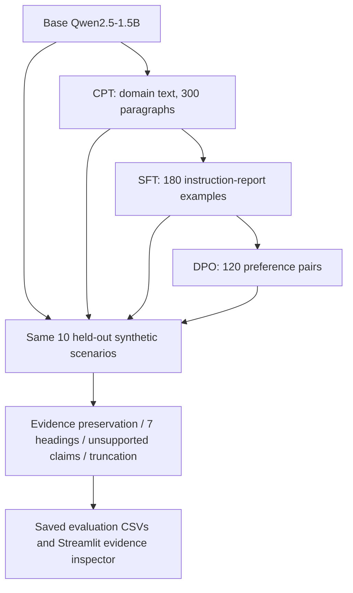
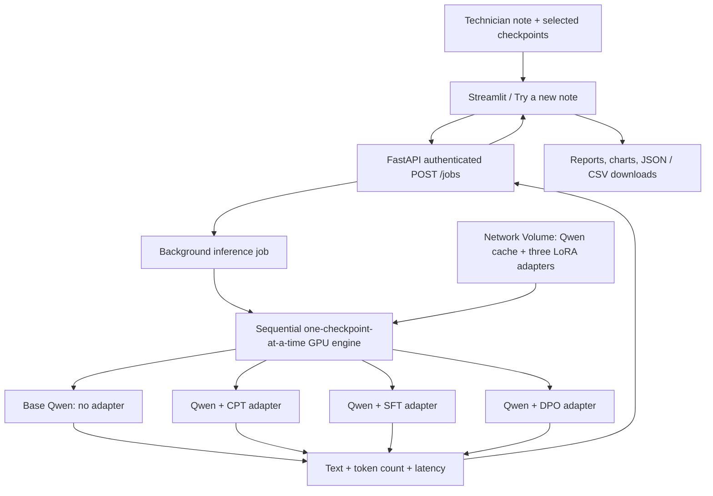
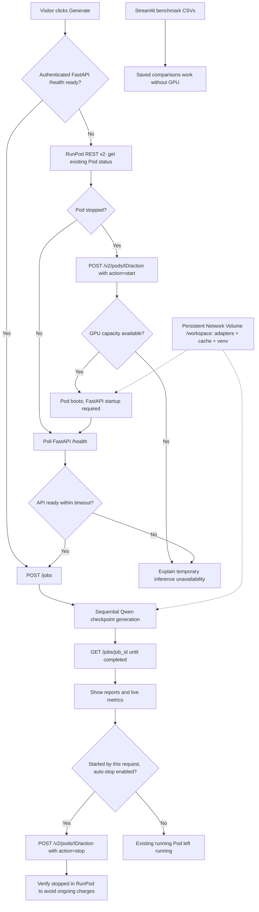

# Industrial Maintenance Document Assistant — An Experimental Analysis of LLM Post-Training and Fine-Tuning

**Continued Pretraining (CPT) · Supervised Fine-Tuning (SFT) · Direct Preference Optimization (DPO) · Comparative Evaluation**

**Domain-specific industrial maintenance documentation assistant and LLM post-training research project.** This prototype transforms unstructured equipment observations and technician notes into structured **draft maintenance reports** for maintenance, operations, and reliability teams. It provides a consistent, reviewable format for reported symptoms, operating conditions, measurements, possible contributors, uncertainty, and suggested follow-up—**without claiming to diagnose equipment faults**.

Alongside the practical document-assistant use case, this independent study compares four Qwen2.5-1.5B checkpoints—Base, continued pretraining (CPT), supervised fine-tuning (SFT), and direct preference optimization (DPO)—to investigate how domain adaptation, instruction-following, and preference alignment influence the accuracy and structure of generated maintenance documentation.

> **Research question:** Does additional post-training improve the reliability of generated reports—or mainly change their structure and learned response preferences?

**Base model:** Qwen2.5-1.5B · **Training:** 4-bit quantization + LoRA/QLoRA · **Environment:** Python / Google Colab / NVIDIA GPU

# Try it out 

**Prototype link:** https://llm-post-training-and-alignment-aug26.streamlit.app/

### How to use the maintenance document assistant

1. **Open the prototype** using the link above and select **Try a new note** in the sidebar.
2. **Enter a technician observation.** Paste a fictional or non-confidential maintenance note describing equipment, symptoms, measurements, timestamps, actions already taken, and any unknowns. Avoid private plant records or sensitive operational data.
3. **Choose checkpoints.** Select **Base Qwen**, **CPT**, **SFT**, and/or **DPO**. For a quick demonstration, start with **SFT**; select multiple checkpoints to compare post-training behavior.
4. **Set the maximum output tokens** using the slider (for example, 350), then click **Generate with my fine-tuned Qwen models**.
5. **Review the generated draft reports.** Inspect the structured maintenance sections side by side. Check that equipment IDs, values, timestamps, negative findings, and uncertainty are preserved; treat suggested contributors as unconfirmed possibilities.
6. **Compare the live metrics.** Explore **Latency**, **Generation speed**, **Schema coverage** (heading presence), and **Token usage**. Download the current outputs as **JSON** and live metrics as **CSV** if needed.
7. **Explore the research results** through **Research overview**, **Checkpoint comparison**, **Evidence inspector**, and **Methods & limits**. These saved benchmark views work even when the live GPU is offline.

**Example fictional maintenance note:**

> During monitoring of centrifugal gas compressor K-204, vibration increased from 2.8 mm/s to 6.4 mm/s over 40 minutes. Discharge temperature rose from 82°C to 96°C while suction pressure remained steady at 18 bar. An intermittent noise was observed near the drive-end bearing. The compressor was placed on standby at 14:35 pending inspection. The cause is unconfirmed; no vibration spectrum analysis or internal inspection has been performed.

**Availability:** Saved benchmark views work when the RunPod GPU is stopped. On **Generate**, the configured Streamlit controller can resume the existing normal RunPod Pod, wait for FastAPI readiness, generate real Qwen reports, and request a stop afterward. A stopped-Pod-to-inference test succeeded on **9 November 2026**; future restarts depend on GPU capacity and health, and shutdown is best-effort.

**Intended workflow:** This is a *drafting and comparison assistant*, not an autonomous maintenance decision-maker. A qualified engineer must check source fidelity and approve any documentation before organizational use. The current prototype is not a certified QA/QC report generator or fault-diagnosis system.

## Background: From Transformers to Post-Training

This project builds on my earlier **Transformer-from-scratch implementation**, where I explored the architecture and mechanics behind language models rather than relying solely on pretrained model APIs.

The next step was to understand what happens *after* pretraining: how a model is adapted to a domain, taught to follow instructions, and aligned with preferred responses. For that reason, this study uses an existing open-weight model and focuses on **post-training methods**, not on rebuilding the transformer architecture.

**Previous work:** [(https://github.com/imavantikahere/transformer-code)]

## Project Objectives

1. Apply **continued pretraining** on a small, synthetic industrial maintenance corpus to study domain adaptation through next-token prediction.
2. Use **instruction SFT** to teach structured maintenance-report generation.
3. Apply **DPO** to train on chosen/rejected response preferences emphasizing evidence-grounded, uncertainty-aware reporting.
4. Compare the saved checkpoints on consistent maintenance scenarios, separating **formatting, evidence completeness, unsupported claims, and preference discrimination**.
5. Build an **interactive Streamlit research dashboard** to present real saved model outputs and evaluation findings.

## Technology Stack

| Technology | Role |
|---|---|
| **Python** | Dataset processing, training orchestration, inference and evaluation |
| **PyTorch** | Underlying tensor operations and model execution |
| **Hugging Face Transformers** | Model loading, tokenization, text generation |
| **Hugging Face Datasets** | JSONL dataset loading, validation and splits |
| **Unsloth** | Memory-efficient model loading and fine-tuning |
| **PEFT / LoRA / QLoRA** | Train adapter parameters with a quantized pretrained model |
| **TRL** | `SFTTrainer` and `DPOTrainer` training workflows |
| **bitsandbytes** | Low-bit quantization and optimizer support |
| **Google Colab + Google Drive** | GPU experimentation and checkpoint persistence |
| **pandas / Matplotlib** | Comparative results, manual-audit exports and plots |
| **Streamlit** | Deployed maintenance-document assistant UI, saved benchmark dashboard, live checkpoint comparisons |
| **FastAPI + Uvicorn** | Authenticated job-based inference API (`POST /jobs`, `GET /jobs/{job_id}`) |
| **RunPod + Network Volume** | GPU-hosted inference and persistent adapter/backend/model-cache storage |
| **Git / GitHub** | Version control and documentation |

## Scope of the Study

**In scope:** dataset preparation, QLoRA-based continued pretraining, instruction SFT, DPO, checkpoint verification, controlled model comparisons, error analysis and reproducible documentation.

**Out of scope:** full foundation-model pretraining, PPO-style RLHF, a separately trained reward model, real-time industrial control, fault confirmation, a production-validated industrial deployment and a live RAG service. A working educational live GPU prototype is deployed, but production-grade safety and QA/QC integration remain out of scope. Retrieval-augmented generation and structured evidence extraction are potential future extensions—not part of this controlled comparison.

The project is an **educational experimental study**, not a production-ready maintenance diagnostic system.

## Experimental Pipeline

The four **separately saved** Qwen2.5-1.5B checkpoints follow sequential training, but inference loads **one stage at a time**; CPT, SFT and DPO adapters are not stacked during generation.



**Experimental control:** Without a direct **Base → SFT** comparator, this sequential study cannot establish CPT's independent causal effect.


## Datasets

All datasets are **synthetic** and designed for this limited educational experiment.

| Dataset | Size | Purpose |
|---|---:|---|
| Maintenance-domain text | 300 paragraphs | Continued pretraining / next-token prediction |
| Instruction-response data | 180 examples (60 scenarios × 3 variants) | Seven-field structured maintenance reports |
| Preference data | 120 chosen/rejected pairs | Cautious, evidence-grounded response selection |
| Comparative benchmark | 10 initial synthetic scenarios | Same-prompt inference and evidence-level review |

**Dataset design considerations:** Train/validation splitting was grouped by underlying scenario or equipment identifier where applicable. The benchmark also requires review for scenario paraphrase overlap. Synthetic labels may omit secondary evidence or contain repeated patterns, so dataset quality is part of the interpretation.

### Target reporting format

```text
Equipment:
Reported issue:
Observed evidence:
Possible contributors (not confirmed):
Missing information:
Recommended follow-up:
Assessment:
```

The reporting objective is to document *what was observed*, distinguish that from *what is hypothesized*, and flag missing information—**not** to issue definitive engineering diagnoses.

## Notebook Walkthrough

| Notebook | Experimental stage | Main output |
|---|---|---|
| `01_data_preprocessing.ipynb` | Clean, validate and prepare raw text, instruction and preference JSONL | Prepared datasets |
| `02_non_instruction_finetuning.ipynb` | Continued pretraining using QLoRA on domain text | Domain adapter + training metrics |
| `03_instruction_sft.ipynb` | Completion-only supervised fine-tuning for report generation | SFT adapter + sample reports |
| `04_dpo_alignment.ipynb` | Preference optimization against chosen/rejected pairs | DPO adapter + preference metrics |
| `05_comparative_evaluation.ipynb` | Same-prompt inference, evidence-level checks, graphs | Comparison tables + manual-audit CSV |

Training follows a sequential pipeline, with each stage saving its adapter independently. The implementation draws on post-training concepts studied through an independent AI bootcamp; the industrial reporting task, comparative framing and evidence-inspection workflow are the applied case study explored here.

## Evaluation & Results

This benchmark compares **four checkpoints on the same 10 synthetic technician notes** (40 generated reports): the original Qwen2.5-1.5B model, the continued-pretraining (CPT) adapter, the instruction SFT adapter, and the preference-optimized DPO adapter. The evaluation uses cached generated reports rather than presenting model-training diagnostics as downstream accuracy.

### Evaluation design

Each report was assessed along independent dimensions:

| Dimension | Definition | Review method |
|---|---|---|
| **Evidence preservation** | Fraction of source-observation checkpoints accurately retained, including critical quantities and qualifiers | 53 checklist items per checkpoint, scored 0/1; AI-assisted single-reviewer labels, with human confirmation recommended |
| **Required-field coverage** | Fraction of the seven target field labels detectable in the report | Automated heading-presence check |
| **Complete seven-field presence** | Share of reports containing all seven required field labels | Automated all-or-nothing heading-presence check |
| **Unsupported observations** | Reports containing fabricated or unsupported source facts, measurements or observed events | Report-level 0/1 audit |
| **Unsupported interpretations** | Reports asserting technical interpretations beyond what source evidence justifies | Report-level 0/1 audit |
| **Visible truncation** | Reports that end mid-sentence or mid-structure | Report-level 0/1 audit |

**Scoring boundary:** Field-presence checks do **not** verify section order, nonempty sections, factual correctness or semantic compliance. The evidence and unsupported-claim annotations are **AI-assisted proposed review judgments**, not independent expert-validated ground truth. This is a descriptive study, not a formal reliability certification.

### Comparative results

| Checkpoint | Evidence preservation | Required-field coverage | All 7 fields present | Unsupported observations | Unsupported interpretations | Visibly truncated |
|---|---:|---:|---:|---:|---:|---:|
| **Base Qwen** | **94.3%** | 10.0% | 0/10 | 0/10 | 6/10 | 3/10 |
| **CPT** | 65.8% | 12.9% | 0/10 | 3/10 | 5/10 | 1/10 |
| **SFT** | 42.7% | **100%** | **10/10** | **0/10** | **1/10** | **0/10** |
| **DPO** | 58.3% | **100%** | **10/10** | 3/10 | 2/10 | **0/10** |

**How to read the table:** Evidence preservation is the average of each case's fraction of retained checklist items (which may differ slightly from a single global sum across all 53 items). The final three columns count **reports flagged** in each category, rather than individual sentences or errors. A report can receive more than one flag.

**These figures reflect the saved assessment files as discussed during development; independent human adjudication has not been established.** Some boundary cases are judgment-sensitive. Do not treat differences here as statistically significant or broadly generalizable.

### Evaluation visualizations


*Figure 1. Evidence preservation compared with coverage of the seven requested fields. The chart was generated from the corrected field-presence metric; the notebook plot title/legend may still use “schema compliance,” which here means field presence only.*


*Figure 2. Number of reports flagged for unsupported observations, unsupported interpretations and visible truncation (10 reports per checkpoint). Annotations are AI-assisted and should be manually checked.*

> **Figure files:** Copy `final_recall_schema.png` and `final_failure_modes.png` from the notebook's Google Drive `results/evaluation_05/` directory into the **same path inside this GitHub repository**. Otherwise these relative Markdown images will not render.

### Interpretation

1. **Base Qwen preserved the most source observations (94.3%)**, but often used longer prose, made unsupported technical inferences (6/10 reports), and visibly truncated 3/10 reports. High recall alone is not sufficient for reliable reporting.
2. **Continued pretraining did not establish a downstream advantage** in this sequential study. CPT retained 65.8% of evidence checkpoints, while generating some repetitive or unwarranted claims such as asserting trend stability or treating brief shuddering as harmless. This comparison does not isolate the causal contribution of CPT.
3. **SFT successfully standardized the output**: all seven field labels appeared in all ten reports, with no visible truncation. However, strict evidence preservation fell to 42.7%, suggesting that concise schema-driven answers can omit important technician observations.
4. **DPO recovered some evidence relative to SFT**: 58.3% vs. 42.7% (**+15.6 percentage points**) with the same seven-field presence. But 3/10 DPO reports were flagged for unsupported observations, compared with 0/10 for SFT. In this benchmark, DPO did not uniformly improve grounding.

**Representative failure case — Pump P-883:** The source note gave a pressure reading of **4.1 bar**, not a pressure fluctuation. The DPO output introduced *“pressure fluctuation”* as a reported observation. The CPT output repeatedly asserted *“trend consistency”* without a documented trend, while both SFT and DPO omitted several secondary details. Base Qwen retained more of the listed evidence but added questionable interpretations.

### DPO optimization diagnostics — not report-quality scores

| Metric | Recorded result |
|---|---:|
| Training steps / completed epochs | 30 / ~1.16 |
| Average training loss | 0.4157 |
| Validation loss | 0.2601 |
| Validation preference reward accuracy | 100% |
| Validation reward margin | +1.4401 |
| Matched LoRA tensors differing between SFT and DPO | 392 / 392 |
| Maximum absolute adapter-weight difference | 0.00154053 |

The saved DPO adapter changed measurably, and the preference metric reached 100% **on a very small synthetic validation split**. It does **not** represent 100% factual accuracy or industrial robustness. Greedy-decoded outputs can also remain unchanged despite changes to model weights.

### Main research finding

> **Post-training optimized different behaviors rather than producing a monotonic increase in report reliability.** SFT and DPO achieved complete seven-field heading presence, but Base Qwen retained more source details. DPO partly improved evidence retention over SFT, while introducing some additional unsupported observations. This is a small, synthetic, AI-assisted review and should be interpreted descriptively.

## Reproducing the Experiments

For a precise directory inventory and Hugging Face dataset publication plan, see [Repository and dataset guide](REPOSITORY_AND_DATASETS.md).

1. Clone the repository and open the notebooks in order in **Google Colab**.
2. Prepare the three synthetic datasets and validate the processed JSONL columns.
3. Select a compatible CUDA GPU for model training or inference.
4. Update each notebook's `ROOT` / `PROJECT_ROOT`, model paths and dataset filenames to match your Google Drive.
5. Run stages 02–04 in sequence, saving adapters separately; run 05 using the exact saved checkpoints.
6. Evaluate the saved outputs; audit evidence preservation, unsupported claims and visible truncation; generate the final figures and exports.
7. Review the AI-assisted labels independently before describing them as expert-verified results.

The notebooks expect a workspace similar to:

```text
llm-post-training-experimental-study/
├── data/
│   └── processed/
│       ├── continued_pretraining.jsonl
│       ├── sft_prepared.jsonl
│       └── dpo_prepared.jsonl
├── models/
│   ├── stage1_non_instruction_adapter/
│   ├── stage2_domain_sft_adapter/
│   └── stage3_dpo_adapter/
└── results/
    ├── metrics/
    ├── comparisons/
    └── evaluation_05/
```

The original base model and trained adapter weights are not embedded in these Markdown instructions. **Do not commit large checkpoints, Google Drive credentials, or access tokens.** Publish code, permissible synthetic data, reports and figures; provide external adapter links only when appropriate.

## Interactive UI and Live Deployment

This project includes an interactive **Streamlit research dashboard** and an optional live GPU inference service for comparing four checkpoints of Qwen2.5-1.5B: **Base Qwen, CPT, SFT, and DPO**. The live application is an educational demonstration, not a validated industrial maintenance or QA/QC decision system.

### Low-Level Inference Architecture

Each selected model checkpoint is loaded **sequentially** against the same source note; the Base Qwen path is evaluated without an adapter.




### User interface

The Streamlit dashboard provides five views:

| View | Function |
| --- | --- |
| Research overview | Saved evaluation summaries and aggregate benchmark charts |
| Checkpoint comparison | Side-by-side saved model outputs for the same synthetic scenario |
| Evidence inspector | Evidence-preservation labels and report-level error flags |
| Try a new note | Actual live inference against selected checkpoints, when the GPU backend is online |
| Methods & limits | Methodology, caveats, and downloadable review data |

In **Try a new note**, visitors enter an unstructured technician observation, select any combination of Base Qwen/CPT/SFT/DPO, choose a maximum output-token limit, and submit a request. The UI shows the resulting reports side by side and a live comparison table and interactive charts for **latency**, **generated token count**, **effective tokens per second**, and **detected live-report headings**. Live outputs and live metrics can be downloaded as JSON and CSV respectively.

The live schema check counts the presence of the seven expected heading labels in a generated report; **it is not an evidence-accuracy, hallucination, or industrial-compliance score**. Live metrics are separate from the project's saved 10-scenario AI-assisted evaluation and do not inherit its benchmark scores.

### Deployment architecture

This is a **normal RunPod GPU Pod**, not a Serverless worker. The Pod ID is fixed in Streamlit Secrets; the controller does not choose another GPU type or provision a replacement Pod automatically.



**Security:** RunPod management and FastAPI Bearer credentials stay server-side. Opening the Streamlit app does not start the Pod; clicking **Generate** does.


### Request lifecycle

1. The user enters a fictional note, selects checkpoints and clicks **Generate**.
2. Streamlit checks authenticated `GET /health` on the configured Pod's port-8000 RunPod proxy.
3. When auto-start is enabled and the Pod is stopped, `streamlit_app/pod_autostart.py` invokes **RunPod REST v2** `POST /v2/pods/{pod_id}/action` with `{"action":"start"}`. The previous `/pods/{pod_id}/start` route returned HTTP 404 and was corrected on 9 November 2026.
4. The Pod must start FastAPI automatically; Streamlit waits up to 8 minutes for the health check. GPU capacity shortages and startup failures can still interrupt generation.
5. Streamlit submits authenticated `POST /jobs` with note, selected stages and token limit. FastAPI enqueues one in-memory job and returns a job ID.
6. Qwen2.5-1.5B runs each selected checkpoint **sequentially** (Base, CPT, SFT, DPO), without stacking separate LoRA adapters. Streamlit polls `GET /jobs/{job_id}`.
7. The app displays outputs and live performance/heading metrics, and offers JSON/CSV exports. Saved benchmark scores are separate.
8. When this request originally started the Pod, the controller **attempts** `{"action":"stop"}` on completion or failure.

**Tested:** A stopped-Pod-to-live-inference cycle succeeded on 9 November 2026. **Not guaranteed:** GPU availability, successful restart, stop delivery, or hard billing protection. A previously running Pod is intentionally not stopped by this controller; Streamlit crashes may skip the stop request. Soft per-process request counters can reset when Streamlit restarts.


### Storage and reproducibility

A 30 GB **RunPod Network Volume** retains the inference assets independent of Pod lifecycle:

```text
/workspace/
  llm-post-training-service/
    backend/                  # deployed backend + boot_pod.sh + start_api.sh + requirements-api.txt
    runtime/venv/             # persistent CUDA/PyTorch/PEFT/Unsloth/FastAPI Python environment
    logs/                     # FastAPI startup logs
  llm-post-training/models/   # three saved LoRA adapter directories
  hf-cache/                   # Qwen model/tokenizer cache
  persistence_test.txt        # optional persistence sentinel
```

The Python virtual environment in `runtime/venv` successfully installed and reported **CUDA: True** on 9 November 2026. It remains reusable across container resets with a compatible Python/CUDA image, unlike container-local Python packages. Network Volume storage stays billable while stopped and is tied to its data center.

```bash
findmnt -T /workspace -o TARGET,SOURCE,FSTYPE
df -h /workspace
find /workspace/llm-post-training/models -name adapter_config.json
ls /workspace/llm-post-training-service/runtime/venv/bin/python
```

The adapters are also backed up as private Hugging Face **model** repositories. Do not commit trained weights, credentials or sensitive equipment records.


### Backend start and public endpoint

| File | Role |
|---|---|
| `streamlit_app/app.py` | Maintenance UI, saved benchmark, live model comparison |
| `streamlit_app/pod_autostart.py` | On-demand normal-Pod start, readiness checks, best-effort stop |
| `gpu_backend/backend.py` | Authenticated FastAPI health, jobs and status |
| `gpu_backend/inference_engine.py` | Loads Base Qwen / CPT / SFT / DPO for actual inference |
| `gpu_backend/requirements-api.txt` | Full GPU inference Python dependencies |
| `gpu_backend/boot_pod.sh` | Persistent Python environment and backend startup wrapper |
| `gpu_backend/start_runpod.sh` | Manual backend-start alternative for the GitHub backend layout |

Expose RunPod **HTTP port 8000**, set `INFERENCE_API_KEY` on the Pod, and ensure the actual container startup hook launches FastAPI on Pod boot. A mere RunPod Start command passed as arguments to `/start.sh` may not execute; FileBrowser images have different entrypoint/post-start behavior. Test an authenticated `GET /health` returning HTTP 200. If automated startup fails, inspect the persistent `llm-post-training-service/logs` folder, and use the current deployed `start_api.sh` as a manual recovery path.

**Streamlit Community Cloud Secrets** (placeholders only):

```toml
GPU_API_URL = "https://YOUR-POD-ID-8000.proxy.runpod.net"
GPU_API_KEY = "YOUR-FASTAPI-INFERENCE-KEY"
RUNPOD_AUTO_START = true
RUNPOD_POD_ID = "YOUR-POD-ID"
RUNPOD_API_KEY = "YOUR-RUNPOD-MANAGEMENT-KEY"
RUNPOD_STOP_AFTER_REQUEST = true
```

`GPU_API_KEY` must match Pod `INFERENCE_API_KEY`. `RUNPOD_API_KEY` is a separate RunPod management credential. A newly created replacement Pod requires updating both `RUNPOD_POD_ID` and `GPU_API_URL`. Neither secret belongs in GitHub.


### Availability, cost and security

- Static Streamlit benchmark pages are available while the GPU is stopped.
- On **Generate**, the controller resumes the **configured normal Pod** rather than dynamically choosing new GPUs or using Serverless. When the Pod was stopped its previous GPU reservation was released; future capacity is not assured.
- RunPod GPU compute billing continues whenever the Pod is running, even without inference. Network Volume storage remains billed while stopped. An auto-stop request is **best-effort**, not a hard expenditure cap.
- One-at-a-time locking and per-process limits are not durable quota controls. Add independent runtime limits, account budget alerts and durable rate limiting before unrestricted public usage.
- No hosted Hugging Face explanation requests are made by the checkpoint comparison. Real inference runs saved Qwen weights; synthetic benchmark reports are separate.
- Keep management keys, FastAPI keys and HF tokens in managed secrets; rotate any that are exposed.


## Limitations & Responsible Use

- **Synthetic, small-scale data:** The corpus and labels are not representative of operational plant data; repeated patterns can inflate validation results.
- **Label quality:** Training targets may omit source observations or include unsupported details, potentially teaching undesirable summarization shortcuts.
- **No demonstrated production validity:** There has been no real equipment testing, operational safety validation or external expert sign-off.
- **Evaluation constraints:** Only 10 synthetic scenarios per checkpoint; rubric decisions are AI-assisted, with no independent engineering adjudication or inter-rater reliability study. Earlier regex proxies can produce false positives; generation length and visible truncation affect comparisons.
- **Schema metric:** The corrected formatting metric tests presence of seven labels, not completeness, ordering or correctness of each field. Base/CPT percentages reflect incidental matching labels, not target-schema adherence.
- **Causal attribution:** Without a matched direct-SFT control, the contribution of continued pretraining cannot be isolated.
- **DPO objective vs. downstream quality:** Preference accuracy on synthetic pairs is not evidence of superior factual reporting.
- **Not for safety-critical decisions:** Outputs must not be used to authorize maintenance actions or diagnose equipment faults without qualified engineering review.

## Future Work

- Audit and improve SFT targets for complete evidence coverage.
- Compare a direct-SFT control against the full continued-pretraining → SFT pipeline.
- Expand the benchmark, obtain independent blinded human/engineering review, and quantify agreement between reviewers.
- Explore structured evidence extraction and validation before report generation.
- Investigate RAG for equipment manuals and maintenance history **as a separate experiment**, where external knowledge is needed.

## Key Takeaway

**More post-training does not automatically mean better task performance.** In this limited benchmark, instruction tuning improved required-field presence while reducing source-evidence completeness; preference optimization partly recovered that completeness but did not eliminate unsupported observations. By assessing **format, evidence retention, grounding and truncation separately**, this study makes those trade-offs visible rather than assuming later training stages must perform better.

---

*Independent learning and research portfolio project. Evaluation annotations were AI-assisted and should be independently reviewed. The live document-assistant prototype is linked near the top; availability depends on the GPU backend.*
