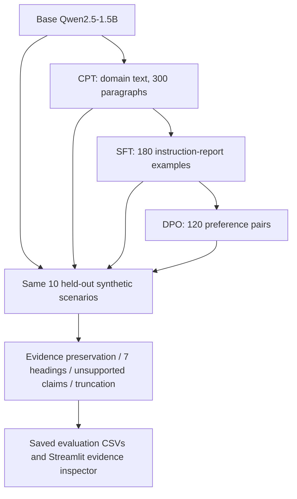
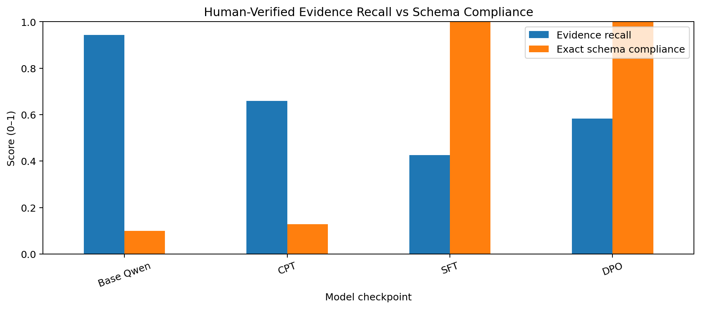
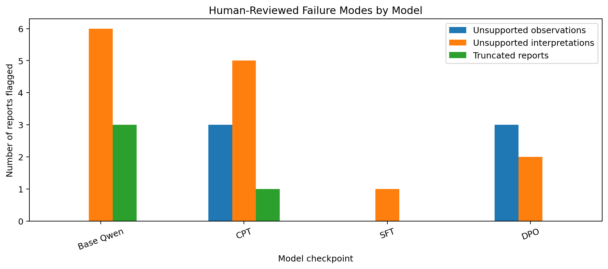
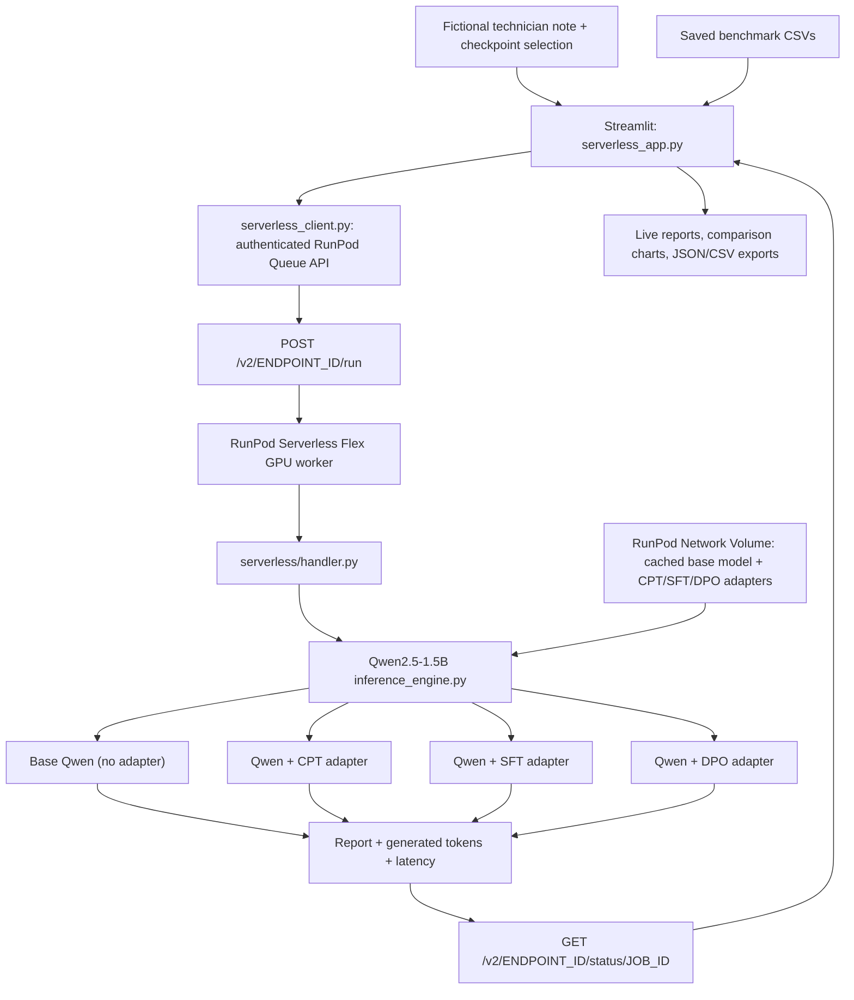

# Industrial Maintenance Document Assistant — An Experimental Analysis of LLM Post-Training and Fine-Tuning

**Continued Pretraining (CPT) · Supervised Fine-Tuning (SFT) · Direct Preference Optimization (DPO) · Comparative Evaluation**

**Domain-specific industrial maintenance documentation assistant and LLM post-training research project.** This prototype transforms unstructured equipment observations and technician notes into structured **draft maintenance reports** for maintenance, operations, and reliability teams. It provides a consistent, reviewable format for reported symptoms, operating conditions, measurements, possible contributors, uncertainty, and suggested follow-up—**without claiming to diagnose equipment faults**.

Alongside the practical document-assistant use case, this independent study compares four Qwen2.5-1.5B checkpoints—Base, continued pretraining (CPT), supervised fine-tuning (SFT), and direct preference optimization (DPO)—to investigate how domain adaptation, instruction-following, and preference alignment influence the accuracy and structure of generated maintenance documentation.

> **Research question:** Does additional post-training improve the reliability of generated reports—or mainly change their structure and learned response preferences?

**Base model:** Qwen2.5-1.5B · **Training:** 4-bit quantization + LoRA/QLoRA · **Environment:** Python / Google Colab / NVIDIA GPU

# Try it out 

**Interactive prototype:** (https://industrial-qwen-serverless.streamlit.app/)

The [original Streamlit prototype](https://llm-post-training-and-alignment-aug26.streamlit.app/) remains in the repository's prior Pod-based setup; availability and current backend configuration may differ. The Serverless frontend is deployed separately; its public URL is not recorded here.

### How to use the maintenance document assistant

1. **Open the prototype** using the link above and select **Try a new note** in the sidebar.
2. **Enter a technician observation.** Paste a fictional or non-confidential maintenance note describing equipment, symptoms, measurements, timestamps, actions already taken, and any unknowns. Avoid private plant records or sensitive operational data.
3. **Choose checkpoints.** Select **Base Qwen**, **CPT**, **SFT**, and/or **DPO**. For a quick demonstration, start with **SFT**; select multiple checkpoints to compare post-training behavior.
4. **Set the maximum output tokens** using the slider (for example, 350), then click **Generate with my fine-tuned Qwen models**.
5. **Review the generated draft reports.** Inspect the structured maintenance sections side by side. Check that equipment IDs, values, timestamps, negative findings, and uncertainty are preserved; treat suggested contributors as unconfirmed possibilities.
6. **Compare the live metrics.** Explore **Latency**, **Generation speed**, **Schema coverage** (heading presence), and **Token usage**. Download the current outputs as **JSON** and live metrics as **CSV** if needed.
7. **Explore the research results** through **Research overview**, **Checkpoint comparison**, **Evidence inspector**, and **Methods & limits**. These saved benchmark views work even when the live GPU is offline.

**Example fictional maintenance note:**

> During monitoring of centrifugal gas compressor K-204, vibration increased from 2.8 mm/s to 6.4 mm/s over 40 minutes. Discharge temperature rose from 82°C to 96°C while suction pressure remained steady at 18 bar. An intermittent noise was observed near the drive-end bearing. The compressor was placed on standby at 14:35 pending inspection. The cause is unconfirmed; no vibration spectrum analysis or internal inspection has been performed.

**Availability:** The saved benchmark views do not require a GPU. The **current live inference implementation** uses RunPod **Queue Serverless (Flex)**: Streamlit submits an asynchronous job, polls its status, and displays actual Qwen generations returned by an on-demand GPU worker. A live Serverless SFT request and an end-to-end Streamlit-to-Serverless multi-checkpoint request **completed successfully on 9 November 2026**. Flex workers can scale to zero, but cold starts, regional GPU shortages, failures and usage charges are still possible. The earlier normal-Pod implementation is preserved as a legacy alternative.

**Intended workflow:** This is a *drafting and comparison assistant*, not an autonomous maintenance decision-maker. A qualified engineer must check source fidelity and approve any documentation before organizational use. The current prototype is not a certified QA/QC report generator or fault-diagnosis system.

## Background: From Transformers to Post-Training

This project builds on my earlier **Transformer-from-scratch implementation**, where I explored the architecture and mechanics behind language models rather than relying solely on pretrained model APIs.

The next step was to understand what happens *after* pretraining: how a model is adapted to a domain, taught to follow instructions, and aligned with preferred responses. For that reason, this study uses an existing open-weight model and focuses on **post-training methods**, not on rebuilding the transformer architecture.

**Previous work:** [(https://github.com/imavantikahere/transformer-code)]

## Project Objectives

1. Apply **continued pretraining** on a small, synthetic industrial maintenance corpus to study domain adaptation through next-token prediction.
2. Use **instruction SFT** to teach structured maintenance-report generation.
3. Apply **DPO** to train on chosen/rejected response preferences emphasizing evidence-grounded, uncertainty-aware reporting.
4. Compare the saved checkpoints on consistent maintenance scenarios, separating **formatting, evidence completeness, unsupported claims, and preference discrimination**.
5. Build and deploy an **interactive Streamlit maintenance-document assistant** presenting saved evaluation findings and providing **live GPU inference** across Base Qwen, CPT, SFT, and DPO checkpoints using RunPod Serverless Queue workers (with the earlier FastAPI/Pod implementation retained for reference).

## Technology Stack

| Technology | Role |
|---|---|
| **Python** | Dataset processing, training orchestration, inference and evaluation |
| **PyTorch** | Underlying tensor operations and model execution |
| **Hugging Face Transformers** | Model loading, tokenization, text generation |
| **Hugging Face Datasets** | JSONL dataset loading, validation and splits |
| **Unsloth** | Memory-efficient model loading and fine-tuning |
| **PEFT / LoRA / QLoRA** | Train adapter parameters with a quantized pretrained model |
| **TRL** | `SFTTrainer` and `DPOTrainer` training workflows |
| **bitsandbytes** | Low-bit quantization and optimizer support |
| **Google Colab + Google Drive** | GPU experimentation and checkpoint persistence |
| **pandas / Matplotlib** | Comparative results, manual-audit exports and plots |
| **Streamlit** | Deployed maintenance-document assistant UI, saved benchmark dashboard, live checkpoint comparisons |
| **RunPod Serverless (Queue / Flex)** | Current on-demand GPU inference, asynchronous `/run` submission and `/status/{job_id}` polling, scale-to-zero workers |
| **Docker + RunPod GitHub image builds** | Reproducible worker image, including C/C++ build tools required for Unsloth/Triton compilation |
| **RunPod Network Volume** | Persistent Qwen base-model cache and three separately saved LoRA adapters shared with Serverless workers |
| **FastAPI + Uvicorn (legacy Pod path)** | Earlier authenticated job API (`POST /jobs`, `GET /jobs/{job_id}`), retained in repository but not the current Serverless request path |
| **Git / GitHub** | Version control and documentation |

## Scope of the Study

**In scope:** dataset preparation, QLoRA-based continued pretraining, instruction SFT, DPO, checkpoint verification, controlled model comparisons, error analysis and reproducible documentation.

**Out of scope:** full foundation-model pretraining, PPO-style RLHF, a separately trained reward model, real-time industrial control, fault confirmation, a production-validated industrial deployment and a live RAG service. A working educational live GPU prototype is deployed, but production-grade safety and QA/QC integration remain out of scope. Retrieval-augmented generation and structured evidence extraction are potential future extensions—not part of this controlled comparison.

The project is an **educational experimental study**, not a production-ready maintenance diagnostic system.

## Experimental Pipeline

The four **separately saved** Qwen2.5-1.5B checkpoints follow sequential training, but inference loads **one stage at a time**; CPT, SFT and DPO adapters are not stacked during generation.



**Experimental control:** Without a direct **Base → SFT** comparator, this sequential study cannot establish CPT's independent causal effect.


## Trained Model Checkpoints (Hugging Face)

These are three **independently saved LoRA adapter checkpoints** from the sequential Qwen2.5-1.5B post-training study, rather than three separately pretrained base models. Inference compares each stage independently with Base Qwen; the adapters are not stacked together during report generation.

| Checkpoint | Hugging Face repository | Post-training purpose |
|---|---|---|
| **CPT** | [industrial-qwen-cpt-lora](https://huggingface.co/imavantika/industrial-qwen-cpt-lora) | Continued pretraining on synthetic industrial maintenance text |
| **SFT** | [industrial-qwen-sft-lora](https://huggingface.co/imavantika/industrial-qwen-sft-lora) | Learn structured maintenance reports from instruction-response examples |
| **DPO** | [industrial-qwen-dpo-lora](https://huggingface.co/imavantika/industrial-qwen-dpo-lora) | Optimize preferences for evidence-aware, uncertainty-conscious reporting |

**Access note:** These repositories may require Hugging Face authentication if their visibility remains private. The public Streamlit demonstration invokes the securely hosted model adapters through RunPod; it does not expose private adapter files to visitors.

## Datasets

All datasets are **synthetic** and designed for this limited educational experiment. The source and processed files below link directly to the corresponding files committed in this repository.

| Dataset | Size | Purpose | Source and prepared files |
|---|---:|---|---|
| Maintenance-domain text | 300 paragraphs | Continued pretraining / next-token prediction | [Original paragraphs](data/raw/industrial_maintenance_raw_300_paragraphs.txt) · [Prepared CPT JSONL](data/processed/continued_pretraining.jsonl) |
| Instruction-response data | 180 examples (60 scenarios × 3 variants) | Seven-field structured maintenance reports | [Instruction examples](data/instruction/industrial_maintenance_instruction_dataset.jsonl) · [Prepared SFT JSONL](data/processed/sft_prepared.jsonl) |
| Preference data | 120 chosen/rejected pairs | Evidence-grounded preference learning | [Preference examples](data/preference/industrial_maintenance_dpo_preference_dataset.jsonl) · [Prepared DPO JSONL](data/processed/dpo_prepared.jsonl) |
| Comparative benchmark | 10 synthetic scenarios across four checkpoints | Same-prompt inference and evidence-level review | [Saved checkpoint outputs](streamlit_app/data/checkpoint_outputs.jsonl) · [Reviewed evidence CSV](streamlit_app/data/evidence_reviewed.csv) · [Reviewed error CSV](streamlit_app/data/error_reviewed.csv) |

The [original source PDF](data/raw/industrial_maintenance_raw.pdf) is also present in the repository; confirm its provenance and redistribution rights before mirroring or licensing it elsewhere.

**Dataset design considerations:** Train/validation splitting was grouped by underlying scenario or equipment identifier where applicable. The benchmark also requires review for scenario paraphrase overlap. Synthetic labels may omit secondary evidence or contain repeated patterns, so dataset quality is part of the interpretation.

## Notebook Walkthrough

| Notebook | Experimental stage | Main output |
|---|---|---|
| `01_data_preprocessing.ipynb` | Clean, validate and prepare raw text, instruction and preference JSONL | Prepared datasets |
| `02_non_instruction_finetuning.ipynb` | Continued pretraining using QLoRA on domain text | Domain adapter + training metrics |
| `03_instruction_sft.ipynb` | Completion-only supervised fine-tuning for report generation | SFT adapter + sample reports |
| `04_dpo_alignment.ipynb` | Preference optimization against chosen/rejected pairs | DPO adapter + preference metrics |
| `05_comparative_evaluation.ipynb` | Same-prompt inference, evidence-level checks, graphs | Comparison tables + manual-audit CSV |

Training follows a sequential pipeline, with each stage saving its adapter independently. The implementation draws on post-training concepts studied through an independent AI bootcamp; the industrial reporting task, comparative framing and evidence-inspection workflow are the applied case study explored here.

## Evaluation & Results

This benchmark compares **four checkpoints on the same 10 synthetic technician notes** (40 generated reports): the original Qwen2.5-1.5B model, the continued-pretraining (CPT) adapter, the instruction SFT adapter, and the preference-optimized DPO adapter. The evaluation uses cached generated reports rather than presenting model-training diagnostics as downstream accuracy.

### Evaluation design

Each report was assessed along independent dimensions:

| Dimension | Definition | Review method |
|---|---|---|
| **Evidence preservation** | Fraction of source-observation checkpoints accurately retained, including critical quantities and qualifiers | 53 checklist items per checkpoint, scored 0/1; AI-assisted single-reviewer labels, with human confirmation recommended |
| **Required-field coverage** | Fraction of the seven target field labels detectable in the report | Automated heading-presence check |
| **Complete seven-field presence** | Share of reports containing all seven required field labels | Automated all-or-nothing heading-presence check |
| **Unsupported observations** | Reports containing fabricated or unsupported source facts, measurements or observed events | Report-level 0/1 audit |
| **Unsupported interpretations** | Reports asserting technical interpretations beyond what source evidence justifies | Report-level 0/1 audit |
| **Visible truncation** | Reports that end mid-sentence or mid-structure | Report-level 0/1 audit |

**Scoring boundary:** Field-presence checks do **not** verify section order, nonempty sections, factual correctness or semantic compliance. The evidence and unsupported-claim annotations are **AI-assisted proposed review judgments**, not independent expert-validated ground truth. This is a descriptive study, not a formal reliability certification.

### Comparative results

| Checkpoint | Evidence preservation | Required-field coverage | All 7 fields present | Unsupported observations | Unsupported interpretations | Visibly truncated |
|---|---:|---:|---:|---:|---:|---:|
| **Base Qwen** | **94.3%** | 10.0% | 0/10 | 0/10 | 6/10 | 3/10 |
| **CPT** | 65.8% | 12.9% | 0/10 | 3/10 | 5/10 | 1/10 |
| **SFT** | 42.7% | **100%** | **10/10** | **0/10** | **1/10** | **0/10** |
| **DPO** | 58.3% | **100%** | **10/10** | 3/10 | 2/10 | **0/10** |

**How to read the table:** Evidence preservation is the average of each case's fraction of retained checklist items (which may differ slightly from a single global sum across all 53 items). The final three columns count **reports flagged** in each category, rather than individual sentences or errors. A report can receive more than one flag.

**These figures reflect the saved assessment files as discussed during development; independent human adjudication has not been established.** Some boundary cases are judgment-sensitive. Do not treat differences here as statistically significant or broadly generalizable.

### Evaluation visualizations




*Figure 1. Evidence preservation compared with coverage of the seven requested fields. The chart was generated from the corrected field-presence metric; the notebook plot title/legend may still use “schema compliance,” which here means field presence only.*




*Figure 2. Number of reports flagged for unsupported observations, unsupported interpretations and visible truncation (10 reports per checkpoint). Annotations are AI-assisted and should be manually checked.*

> **Figure sources:** Both images are already tracked in `results/evaluation_05/` alongside the saved evaluation CSVs.

### Interpretation

1. **Base Qwen preserved the most source observations (94.3%)**, but often used longer prose, made unsupported technical inferences (6/10 reports), and visibly truncated 3/10 reports. High recall alone is not sufficient for reliable reporting.
2. **Continued pretraining did not establish a downstream advantage** in this sequential study. CPT retained 65.8% of evidence checkpoints, while generating some repetitive or unwarranted claims such as asserting trend stability or treating brief shuddering as harmless. This comparison does not isolate the causal contribution of CPT.
3. **SFT successfully standardized the output**: all seven field labels appeared in all ten reports, with no visible truncation. However, strict evidence preservation fell to 42.7%, suggesting that concise schema-driven answers can omit important technician observations.
4. **DPO recovered some evidence relative to SFT**: 58.3% vs. 42.7% (**+15.6 percentage points**) with the same seven-field presence. But 3/10 DPO reports were flagged for unsupported observations, compared with 0/10 for SFT. In this benchmark, DPO did not uniformly improve grounding.

**Representative failure case — Pump P-883:** The source note gave a pressure reading of **4.1 bar**, not a pressure fluctuation. The DPO output introduced *“pressure fluctuation”* as a reported observation. The CPT output repeatedly asserted *“trend consistency”* without a documented trend, while both SFT and DPO omitted several secondary details. Base Qwen retained more of the listed evidence but added questionable interpretations.

### DPO optimization diagnostics — not report-quality scores

| Metric | Recorded result |
|---|---:|
| Training steps / completed epochs | 30 / ~1.16 |
| Average training loss | 0.4157 |
| Validation loss | 0.2601 |
| Validation preference reward accuracy | 100% |
| Validation reward margin | +1.4401 |
| Matched LoRA tensors differing between SFT and DPO | 392 / 392 |
| Maximum absolute adapter-weight difference | 0.00154053 |

The saved DPO adapter changed measurably, and the preference metric reached 100% **on a very small synthetic validation split**. It does **not** represent 100% factual accuracy or industrial robustness. Greedy-decoded outputs can also remain unchanged despite changes to model weights.

### Main research finding

> **Post-training optimized different behaviors rather than producing a monotonic increase in report reliability.** SFT and DPO achieved complete seven-field heading presence, but Base Qwen retained more source details. DPO partly improved evidence retention over SFT, while introducing some additional unsupported observations. This is a small, synthetic, AI-assisted review and should be interpreted descriptively.

## Reproducing the Experiments

For a precise directory inventory and Hugging Face dataset publication plan, see [Repository and dataset guide](REPOSITORY_AND_DATASETS.md).

1. Clone the repository and open the notebooks in order in **Google Colab**.
2. Prepare the three synthetic datasets and validate the processed JSONL columns.
3. Select a compatible CUDA GPU for model training or inference.
4. Update each notebook's `ROOT` / `PROJECT_ROOT`, model paths and dataset filenames to match your Google Drive.
5. Run stages 02–04 in sequence, saving adapters separately; run 05 using the exact saved checkpoints.
6. Evaluate the saved outputs; audit evidence preservation, unsupported claims and visible truncation; generate the final figures and exports.
7. Review the AI-assisted labels independently before describing them as expert-verified results.

The notebooks expect a workspace similar to:

```text
llm-post-training-experimental-study/
├── data/
│   └── processed/
│       ├── continued_pretraining.jsonl
│       ├── sft_prepared.jsonl
│       └── dpo_prepared.jsonl
├── models/
│   ├── stage1_non_instruction_adapter/
│   ├── stage2_domain_sft_adapter/
│   └── stage3_dpo_adapter/
└── results/
    ├── metrics/
    ├── comparisons/
    └── evaluation_05/
```

The original base model and trained adapter weights are not embedded in these Markdown instructions. **Do not commit large checkpoints, Google Drive credentials, or access tokens.** Publish code, permissible synthetic data, reports and figures; provide external adapter links only when appropriate.

## Interactive UI and Live Deployment

This project includes an interactive **Streamlit research dashboard** and an optional live GPU inference service for comparing four checkpoints of Qwen2.5-1.5B: **Base Qwen, CPT, SFT, and DPO**. The live application is an educational demonstration, not a validated industrial maintenance or QA/QC decision system.

### Low-Level Inference Architecture

The **current live demo** uses **RunPod Serverless Queue-based Flex workers**, not a permanently running GPU Pod. Streamlit submits an authenticated job to RunPod's API, polls its status, and renders the report and live comparison metrics. The worker uses the existing `gpu_backend/inference_engine.py`; each selected checkpoint is evaluated **sequentially**, without stacking the separately saved adapters.



**Why Serverless?** The original approach used a **normal RunPod Pod** with persistent Network Volume storage and automatic start/stop through RunPod's Pod API. The volume preserved weights, adapters and the Python environment, but **did not guarantee GPU host persistence or capacity**: after the Pod was stopped, a later restart returned **HTTP 400: “There are not enough free GPUs on the host machine to start this pod.”** This made the fixed-Pod approach unreliable for a demonstration that should start on demand. Moving to Serverless Queue workers decoupled job scheduling from restarting that specific Pod host, provided asynchronous status tracking, and allowed idle GPU workers to scale to zero.

**Operational trade-off:** Serverless is **not guaranteed GPU availability**. The first endpoint configuration could not immediately allocate a worker with the selected 24 GB hardware; selecting an available **NVIDIA A40 (48 GB)** configuration allowed the test worker to start. The worker then exposed a runtime **Unsloth/Triton “Failed to find C compiler”** error, resolved by adding `build-essential` in a separate compiler-enabled Dockerfile. The successful inference run produced a real SFT maintenance report; the Streamlit frontend subsequently performed a successful multi-checkpoint request.

### User interface

The Streamlit dashboard provides five views:

| View | Function |
| --- | --- |
| Research overview | Saved evaluation summaries and aggregate benchmark charts |
| Checkpoint comparison | Side-by-side saved model outputs for the same synthetic scenario |
| Evidence inspector | Evidence-preservation labels and report-level error flags |
| Try a new note | Actual live inference against selected checkpoints, when the GPU backend is online |
| Methods & limits | Methodology, caveats, and downloadable review data |

In **Try a new note**, visitors enter an unstructured technician observation, select any combination of Base Qwen/CPT/SFT/DPO, choose a maximum output-token limit, and submit a request. The UI shows the resulting reports side by side and a live comparison table and interactive charts for **latency**, **generated token count**, **effective tokens per second**, and **detected live-report headings**. Live outputs and live metrics can be downloaded as JSON and CSV respectively.

The live schema check counts the presence of the seven expected heading labels in a generated report; **it is not an evidence-accuracy, hallucination, or industrial-compliance score**. Live metrics are separate from the project's saved 10-scenario AI-assisted evaluation and do not inherit its benchmark scores.

### Current deployment architecture — RunPod Serverless

**Endpoint type:** Queue-based RunPod Serverless **Flex**, configured with **0 active (always-on) workers** and **1 maximum worker** for controlled testing. The successfully tested worker used an **NVIDIA A40 48 GB GPU**. The GPU memory size is an allocation choice, **not** a minimum model requirement or a promise of future capacity. Flex workers are provisioned on demand and can scale back to zero when idle.

**Storage:** The existing 30 GB RunPod Network Volume retains the Qwen base-model cache and the three LoRA adapter directories. The volume is exposed to the Serverless container at `/runpod-volume`, rather than the old Pod's `/workspace` path:

```text
/runpod-volume/
  llm-post-training/models/
    stage1_non_instruction_adapter/
    stage2_domain_sft_adapter/
    stage3_dpo_adapter/
  hf-cache/
```

The model cache and adapters survive worker termination, while software dependencies are installed in the **Docker image**. The Network Volume is **tied to a specific data center**, which restricts Serverless worker placement and can still cause queue delays. Volume storage charges can continue when no GPU worker is active.

### Serverless request lifecycle

1. A user enters a **fictional or non-confidential** technician note and selects Base Qwen, CPT, SFT and/or DPO in `streamlit_app/serverless_app.py`.
2. `streamlit_app/serverless_client.py` authenticates with a RunPod API key stored in Streamlit Secrets and submits `POST https://api.runpod.ai/v2/{endpoint_id}/run`.
3. RunPod queues the job and allocates a compatible GPU worker, subject to regional capacity and the attached Network Volume.
4. The [Serverless handler](gpu_backend/serverless/handler.py) validates input, checks that adapters are mounted, and calls the existing [inference engine](gpu_backend/inference_engine.py).
5. The engine loads/runs each requested checkpoint **sequentially**, returning generated reports and per-checkpoint metrics.
6. Streamlit polls `GET https://api.runpod.ai/v2/{endpoint_id}/status/{job_id}` until completion or failure, displays the reports, and provides the live charts and downloads.
7. With zero configured active workers, RunPod can scale workers down after inactivity. A completed job **does not** guarantee that the worker immediately stops billing; check the Workers and billing screens.

**Validated on 9 November 2026:** successful container build, actual A40 GPU allocation, C-compiler dependency fix, a completed SFT inference request, and an end-to-end live Streamlit request with multiple trained checkpoints. This is an **engineering demonstration**, not a service-level availability guarantee or production validation.

### Serverless implementation and reproduction

| File | Responsibility |
|---|---|
| [`streamlit_app/serverless_app.py`](streamlit_app/serverless_app.py) | Standalone Streamlit frontend: saved benchmarks, real inference and live charts |
| [`streamlit_app/serverless_client.py`](streamlit_app/serverless_client.py) | Asynchronous RunPod Queue request, status polling and timeout handling |
| [`gpu_backend/serverless/handler.py`](gpu_backend/serverless/handler.py) | RunPod job handler, input validation, adapter checks and inference engine call |
| [`gpu_backend/serverless/Dockerfile.compiler`](gpu_backend/serverless/Dockerfile.compiler) | **Successfully deployed fix**: runtime image with GCC/G++ for Unsloth/Triton JIT compilation |
| [`gpu_backend/serverless/Dockerfile`](gpu_backend/serverless/Dockerfile) | Initial image definition; lacked the system C compiler and failed at inference |
| [`gpu_backend/serverless/requirements.txt`](gpu_backend/serverless/requirements.txt) | RunPod SDK and model-inference dependencies |
| [`gpu_backend/inference_engine.py`](gpu_backend/inference_engine.py) | Shared Qwen base/CPT/SFT/DPO model execution, unchanged |
| [`gpu_backend/serverless/DEPLOYMENT.md`](gpu_backend/serverless/DEPLOYMENT.md) | Step-by-step deployment guidance and known constraints |

**Reproduce the Serverless deployment:** Connect the GitHub repository to RunPod, create a **Queue** Serverless endpoint, use the repository root as the build context and `gpu_backend/serverless/Dockerfile.compiler` as the Dockerfile path, attach the original Network Volume, set active workers to **0** and max workers to **1**, and deploy. Verify the build before sending **one** real inference request. See the detailed [Serverless deployment guide](gpu_backend/serverless/DEPLOYMENT.md); if that guide refers to `Dockerfile`, use the **compiler-enabled** variant for the tested configuration.

Deploy a **separate** Streamlit Community Cloud app with main file path `streamlit_app/serverless_app.py`, and store credentials only in the new app's Secrets:

```toml
SERVERLESS_ENDPOINT_ID = "YOUR_RUNPOD_SERVERLESS_ENDPOINT_ID"
SERVERLESS_API_KEY = "YOUR_RUNPOD_API_KEY"
```

The live **Generate** action has **no visitor password gate**. Anyone with access to the deployed Streamlit app can trigger billable GPU jobs. Restrict app access or add a robust authenticated usage quota before broad public sharing; **max workers = 1 is not a spending cap**. Do not commit credentials or share them in screenshots.

### Prior implementation — normal RunPod Pod + FastAPI (retained)

The original deployment used `streamlit_app/app.py`, `streamlit_app/pod_autostart.py`, and `gpu_backend/backend.py` to start a **fixed Pod**, poll FastAPI `/health`, submit `POST /jobs`, poll `GET /jobs/{job_id}`, and attempt to stop the Pod afterward. A stopped-Pod-to-inference test did succeed on **9 November 2026**, but subsequent Pod restart failed because the original host could not provide the GPU again. This was the practical **GPU persistence/availability** limitation that motivated Serverless. The legacy source files were preserved rather than overwritten.

Normal-Pod secrets (`GPU_API_URL`, `GPU_API_KEY`, `RUNPOD_POD_ID`, `RUNPOD_API_KEY`, etc.) are **not used** by the separate Serverless Streamlit entrypoint.

### Availability, cost and security

- **Scale-to-zero is not a GPU guarantee:** Capacity shortages, cold-start image downloads, regional Network Volume restrictions and worker errors can delay or prevent requests.
- **Workers may incur charges during startup, execution and idle transitions.** The volume may continue accruing storage costs even with zero running workers. The observed A40 console rate during testing was **$0.00034/s** (approximately **$1.22/hr** at that rate); current pricing should be verified in RunPod before reuse.
- **Max workers = 1 limits concurrency, not cumulative spending.** The $20 testing budget is a personal target, not a hard billing control. The Streamlit inference tab has **no visitor password**; avoid unrestricted public sharing without durable quotas, authentication and monitoring.
- **Security:** RunPod API keys live server-side in Streamlit Secrets; trained checkpoints and persistent storage are not exposed to visitors. There is **no inference access-code field**; appropriate authentication, abuse controls and usage limits are needed before broad public availability.
- **Evaluation integrity:** New live reports produce latency/token/heading-presence metrics but **do not inherit the saved benchmark's evidence-retention or unsupported-claim scores**. Technical recommendations remain unverified drafting suggestions.

## Limitations & Responsible Use

- **Synthetic, small-scale data:** The corpus and labels are not representative of operational plant data; repeated patterns can inflate validation results.
- **Label quality:** Training targets may omit source observations or include unsupported details, potentially teaching undesirable summarization shortcuts.
- **No demonstrated production validity:** There has been no real equipment testing, operational safety validation or external expert sign-off.
- **Evaluation constraints:** Only 10 synthetic scenarios per checkpoint; rubric decisions are AI-assisted, with no independent engineering adjudication or inter-rater reliability study. Earlier regex proxies can produce false positives; generation length and visible truncation affect comparisons.
- **Schema metric:** The corrected formatting metric tests presence of seven labels, not completeness, ordering or correctness of each field. Base/CPT percentages reflect incidental matching labels, not target-schema adherence.
- **Causal attribution:** Without a matched direct-SFT control, the contribution of continued pretraining cannot be isolated.
- **DPO objective vs. downstream quality:** Preference accuracy on synthetic pairs is not evidence of superior factual reporting.
- **Not for safety-critical decisions:** Outputs must not be used to authorize maintenance actions or diagnose equipment faults without qualified engineering review.

## Future Work

- Audit and improve SFT targets for complete evidence coverage.
- Compare a direct-SFT control against the full continued-pretraining → SFT pipeline.
- Expand the benchmark, obtain independent blinded human/engineering review, and quantify agreement between reviewers.
- Explore structured evidence extraction and validation before report generation.
- Investigate RAG for equipment manuals and maintenance history **as a separate experiment**, where external knowledge is needed.

## Key Takeaway

**More post-training does not automatically mean better task performance.** In this limited benchmark, instruction tuning improved required-field presence while reducing source-evidence completeness; preference optimization partly recovered that completeness but did not eliminate unsupported observations. By assessing **format, evidence retention, grounding and truncation separately**, this study makes those trade-offs visible rather than assuming later training stages must perform better.

## Authorship, AI-Assisted Reference & Rights

**Independent work by Avantika Poddar.** The theoretical foundations, conceptual understanding, experimental design and applied research approach in this project arise from Avantika Poddar's independent learning.

AI tools were used as **references to cross-check code logic, syntax, and implementation details**. AI-assisted evaluation annotations are identified as such in the methodology and are not presented as independently expert-validated results.

**© 2026 Avantika Poddar. All rights reserved.** No general open-source license or permission to redistribute this project's original content is granted by this notice. Third-party software, pretrained models and any third-party content remain subject to their respective licenses and rights.
